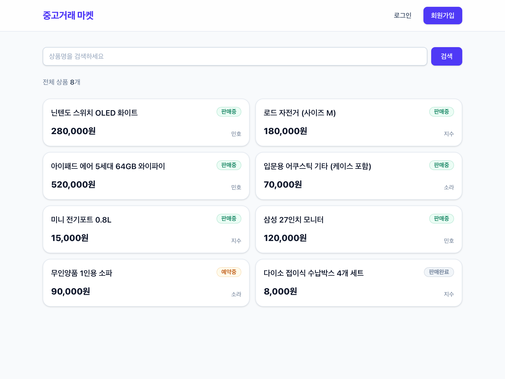

# 중고거래 플랫폼

Claude Code 학습을 위한 예제 프로젝트.

Java / Spring Boot(Web MVC) / PostgreSQL 백엔드 + TypeScript / React / Vite / Tailwind 프론트엔드.
Outside-in TDD(Playwright E2E 먼저)로 개발했다. 문서: [PRD](docs/01-PRD.md) · [SPEC](docs/02-SPEC.md) · [PLAN](docs/03-PLAN.md) · [devlog](docs/devlog/README.md) · [샘플 스크린샷](screenshots/README.md)



## 요구 사항
JDK 17+, Node 20+, Docker (PostgreSQL, Testcontainers)

## 포트
| 대상 | 포트 |
|---|---|
| Frontend | 25800 |
| Backend | 25801 |
| E2E DB | 25802 |
| 개발 DB | 25803 |

## 실행
```bash
docker compose up -d postgres            # 개발 DB (25803)
cd backend && ./gradlew bootRun          # http://localhost:25801
cd frontend && npm install && npm run dev  # http://localhost:25800
```

## 테스트
```bash
cd backend && ./gradlew test             # JUnit (Testcontainers, Docker 필요)
cd frontend && npm test                  # Vitest
docker compose up -d postgres-e2e        # E2E 전용 DB (25802)
cd frontend && npx playwright install chromium   # 최초 1회
cd frontend && npm run e2e               # Playwright (서버 자동 기동)
```
주의: 개발 서버가 떠 있으면 E2E가 그 서버를 재사용해 개발 DB에 데이터를 쓴다. E2E 전에 서버를 끈다.

## 서버 종료 (이 프로젝트 것만)
`scripts/stop-servers.sh [--dry-run] [--with-db]` — 포트 25800/25801에서 작업 디렉터리가 이 프로젝트인 프로세스만 종료한다. `pkill` 등 패턴 기반 종료는 사용하지 않는다. 자세한 규칙은 [CLAUDE.md](CLAUDE.md).

## 기능
회원가입/로그인(JWT) · 상품 등록 · 목록/검색 · 상세 · 수정/삭제(본인) · 판매 상태 변경(판매중/예약중/판매완료)

## 테스트 현황
E2E(Playwright) 26 · Vitest 23 · JUnit 25 — 모두 통과 (2026-10-14). 시나리오 매핑은 [SPEC §6](docs/02-SPEC.md).

## 알려진 한계
목록 UI는 첫 20개만 표시, 토큰 만료 처리 없음(로그아웃은 클라이언트에서 토큰 폐기), 검색어 와일드카드 미이스케이프 등. 전체 목록은 [SPEC §9](docs/02-SPEC.md).

## 프로젝트 지침
[AGENTS.md](AGENTS.md)(`CLAUDE.md`는 심볼릭 링크)에 포트, 서버 종료 규칙, 개발 방식, 문서 동기화 규칙이 있다.
